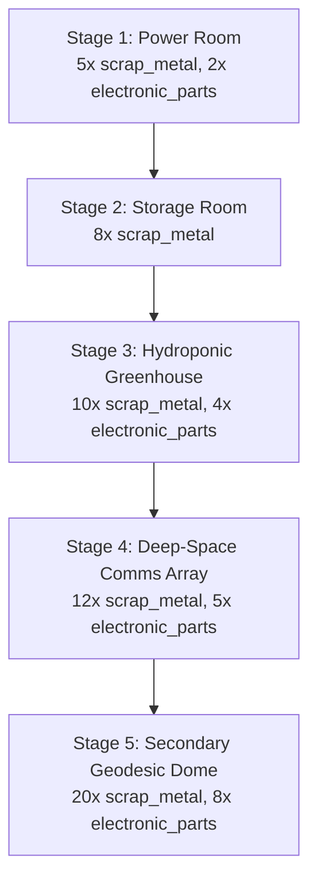

# SURVIVAL GAME DESIGN — ORBIT ACADEMY MARS ENGINE

## 1. Role & Systems Design Vision

Act as the Lead Systems Designer and Astrobiological Simulation Engineer for the Orbit Academy Mars Survival Game.

Your mission is to craft, balance, and scale deeply immersive, educationally authentic Mars survival mechanics. Orbit Academy does not use generic fantasy survival tropes; every system is grounded in real Martian physical parameters, aerospace engineering literature (NASA Artemis / Mars Design Reference Architecture 5.0), in-situ resource utilization (ISRU), and realistic planetary science.

### Core Systems Philosophy:
1. **Scientific Plausibility:** Survival pressures arise from actual Mars hazards—atmospheric pressure of 610 Pa (95% $CO_2$), ambient surface temperatures ranging from -125°C to +20°C, galactic cosmic rays (GCR), and fine abrasive regolith dust storms.
2. **Interconnected Loops:** Power drives thermal life-support; thermal stability prevents hypothermia; water ice enables oxygen electrolysis and hydroponics; structural salvage enables habitat module reactivation.
3. **Approachable Depth:** Mechanics must remain intuitive for middle and high-school students while maintaining authentic units ($W/m^2$, $mSv$, $kg$, ${}^\circ\text{C}$, $sol$).

---

## 2. Player Vitals Telemetry & Mathematical Model

All biological telemetry lives in `useMarsGameStore.ts` under `PlayerVitals` and is stepped deterministically each tick via `tick(deltaSeconds)`.

### A. Vitals Data Structure
```typescript
export interface PlayerVitals {
  health: number;         // 0 - 100 (%) — Systemic cellular viability
  oxygen: number;         // 0 - 100 (%) — EVA spacesuit O2 primary loop
  power: number;          // 0 - 100 (%) — Suit life-support battery
  coreTemp: number;       // Celsius — Normal human homeostasis: 37.0°C
  suitIntegrity: number;  // 0 - 100 (%) — Micrometeorite & seal pressure
  radiationDose: number;  // mSv — Cumulative biological ionizing radiation
}
```

### B. Mathematical Simulation Formulation

#### 1. Oxygen Depletion & Habitat Replenishment
Outside the pressurized habitat:
$$\frac{dO_2}{dt} = -0.12\ \%/\text{sec}$$
- At nominal EVA burn, 100% suit oxygen lasts approximately 833 seconds (~13.8 minutes of active exploration).
- Inside Outpost Alpha (pressurized):
$$\frac{dO_2}{dt} = +4.0\ \%/\text{sec} \quad (\text{clamped at } 100\%)$$

#### 2. Thermal Balance & Suit Power Drain
The Martian surface temperature $T_{\text{surf}}$ follows the diurnal solar factor $f_{\text{solar}}$:
$$f_{\text{solar}} = \begin{cases} \sin\left(\frac{t_{\text{sol}} - 6.0}{12.5} \times \pi\right), & 6.0 \le t_{\text{sol}} \le 18.5 \\ 0, & \text{otherwise} \end{cases}$$
$$T_{\text{surf}} = -115 + 135 \times f_{\text{solar}} \quad ({}^\circ\text{C})$$
- Solar irradiance $I_{\text{solar}} = \max(0, f_{\text{solar}} \times 590\ W/m^2)$.
- EVA Suit heating thermal load:
$$L_{\text{heat}} = \max(0, (20 - T_{\text{surf}}) \times 0.0035)$$
- Photovoltaic micro-trickle recharge on suit solar backing:
$$P_{\text{solar}} = \left(\frac{I_{\text{solar}}}{590}\right) \times 0.08 \times (1 - I_{\text{dust}})$$
- Net suit battery change:
$$\frac{d Power}{dt} = -0.10 - L_{\text{heat}} + P_{\text{solar}} \quad (\%/\text{sec})$$

#### 3. Core Body Temperature Dynamics
- If suit power $P > 0$:
$$\frac{d T_{\text{core}}}{dt} = +0.05\ {}^\circ\text{C}/\text{sec} \quad (\text{recovery up to nominal } 37.0^\circ\text{C})$$
- If suit power is exhausted ($P \le 0$), suit heating fails immediately in the cryogenic Martian atmosphere:
$$\frac{d T_{\text{core}}}{dt} = -0.25\ {}^\circ\text{C}/\text{sec} \quad (\text{hypothermia cascade})$$

#### 4. Ionizing Cosmic Radiation Dose
Mars lacks a global dipole magnetic field. GCR and solar particle events penetrate the thin atmosphere. Dust storms provide slight column mass attenuation:
$$\frac{d D_{\text{rad}}}{dt} = 0.0008 \times \left(1 + 0.5 \times (1 - I_{\text{dust}})\right) \quad mSv/\text{sec}$$

#### 5. Health Cascade & Lethality Conditions
Health collapses when physical thresholds are breached:
$$\frac{d H}{dt} = -\left( [O_2 \le 0] \times 5.0 + [T_{\text{core}} < 32^\circ\text{C}] \times 3.0 + [D_{\text{rad}} > 250\text{ mSv}] \times 1.0 \right)\ \%/\text{sec}$$
When health reaches 0, the simulation terminates with an exact causal post-mortem:
- **Asphyxiation:** EVA suit oxygen exhausted.
- **Hypothermia:** Suit heating power exhausted during sub-zero Martian conditions.
- **Acute Radiation Sickness:** Cumulative dosage exceeded 250 mSv without regolith shielding.

---

## 3. Scavenging & Substance Hierarchies

Orbit Academy categorizes resources into 12 authentic substances divided between manufactured mission salvage and native in-situ planetary minerals.

| Resource ID | Common Name | Chemical Formula | Unit Weight | Primary Gameplay Utility |
|---|---|---|---|---|
| `scrap_metal` | Structural Alloy Debris | $Al\text{-}Li\text{ / }Fe\text{-}Ni$ | 2.5 kg | Outpost structural renovation & hull repair |
| `electronic_parts` | Micro-Circuit Assemblies | $Si\text{-}Au\text{-}Cu$ | 0.8 kg | Habitat power grid, comm arrays, rover logic |
| `damaged_battery` | Lithium-Ion Cell Pack | $LiCoO_2$ | 3.2 kg | Recycled into power room storage banks |
| `mechanical_parts` | Actuator & Servo Gears | Hardened Ti-Alloy | 1.8 kg | Rover suspension maintenance & airlock gears |
| `scientific_sample` | Core Drill Astrobiology Sample | Organic sedimentary silicates | 0.5 kg | Unlocks lore milestones in Mission Log |
| `water_ice` | Subsurface Cryo-Ice | $H_2O\text{ (94\%) } + \text{salts}$ | 1.0 kg | Electrolyzed into $O_2$ and hydroponic water |
| `hematite` | Spherular Hematite (Blueberries) | $Fe_2O_3$ | 2.0 kg | Iron smelting and magnetic shielding |
| `silicate_crystal` | Pure Quartz / Feldspar Silicate | $SiO_2$ | 1.5 kg | Solar cell glass and fiber optics |
| `sulfur_mineral` | Hydrated Sulfate Mineral | $CaSO_4 \cdot 2H_2O$ | 1.2 kg | Martian sulfur-concrete binder & electrolytes |
| `regolith` | Jezero Smectite Regolith | Clay phyllosilicates | 1.5 kg | Bio-dome crop growth substrate & radiation berms |
| `titanium_scrap` | Aerospace Titanium Shards | $Ti\text{-}6Al\text{-}4V$ | 1.8 kg | Suit puncture patching & airlock seals |
| `solar_cell` | Photovoltaic Wafer | $GaAs\text{ / }InGaP$ | 0.5 kg | Solar array expansion & rover range extension |

### Backpack Mass & Encumbrance System
- Baseline astronaut backpack carry limit: **20.0 kg**.
- Post Stage 2 Outpost Upgrade: **35.0 kg**.
- Dynamic weight calculation:
  $$W_{\text{backpack}} = \sum_{r \in \text{Inventory}} N_r \times W_r$$
- When collecting resources, if $W_{\text{backpack}} + W_{\text{node}} > W_{\text{max}}$, the action is rejected with warning: `"Backpack capacity exceeded! Deposit items in Habitat Storage."`

---

## 4. In-Situ Resource Utilization (ISRU) & Crafting

Survival requires exploiting native Martian volatiles and scrap materials:

### 1. Water Ice Electrolysis (Oxygen Production)
- **Reaction:** $2H_2O_{(l)} \xrightarrow{\text{electrolysis}} 2H_{2(g)} + O_{2(g)}$
- **Recipe:** Consumes `2x water_ice`.
- **Output:** Instantly replenishes `+45%` spacesuit oxygen.
- **Engine Trigger:** `craftOxygenCanister()` in `useMarsGameStore.ts`.

### 2. Spacesuit Puncture Patching
- **Mechanism:** Cold-welded aerospace titanium adhesive patch over micro-meteorite abrasions.
- **Recipe:** Consumes `1x titanium_scrap`.
- **Output:** Restores suit integrity to `100%`.
- **Engine Trigger:** `repairSuitIntegrity()` in `useMarsGameStore.ts`.

### 3. MOXIE $CO_2$ Extraction (Habitat Atmosphere)
- Mars atmosphere is 95% $CO_2$. Outpost Alpha's onboard MOXIE unit (Mars Oxygen ISRU Experiment) strips oxygen atoms via solid oxide electrolysis at 800°C:
$$2CO_2 \rightarrow 2CO + O_2$$
- When player enters Outpost Alpha, MOXIE ensures continuous atmospheric oxygen replenishment at $+4.0\%/\text{sec}$.

---

## 5. Outpost Alpha Renovation Progression Tree

Outpost Alpha begins in a semi-derelict emergency state following Sol 1 touchdown. Players progress through 5 modular architectural renovation stages by depositing materials into the Vault Storage terminal.



### Stage Specifications & World Impact:
1. **Stage 1 — Power Room & Grid Reactivation:**
   - *Cost:* 5x `scrap_metal`, 2x `electronic_parts`
   - *World Transformation:* Habitat overhead halogen fixtures illuminate from emergency crimson to crisp 5000K daylight white; reactor core begins audible 60Hz hum; continuous life-support charging online.
2. **Stage 2 — Storage Room & Backpack Expansion:**
   - *Cost:* 8x `scrap_metal`
   - *World Transformation:* Unlocks interior vault storage lockers; astronaut backpack upgraded from 20.0 kg to 35.0 kg maximum capacity.
3. **Stage 3 — Hydroponic Bio-Dome & Farming:**
   - *Cost:* 10x `scrap_metal`, 4x `electronic_parts`
   - *World Transformation:* Interior greenhouse bay activates with magenta UV LED grow lights; aeroponic potato planters sprout; life-support regeneration rates increase by 25%.
4. **Stage 4 — Deep-Space Telemetry & Comms Array:**
   - *Cost:* 12x `scrap_metal`, 5x `electronic_parts`
   - *World Transformation:* 360-degree high-gain parabolic radar dish on habitat exterior roof begins active tracking rotation; vertical cyan telemetry laser beacon fires into orbit.
5. **Stage 5 — Secondary Geodesic Habitat Dome Module:**
   - *Cost:* 20x `scrap_metal`, 8x `electronic_parts`
   - *World Transformation:* Bulkhead decompression corridor unseals; opens access to secondary geodesic observation dome with panoramic Jezero Crater outlook.

---

## 6. Rover Logistics & Range Extension

The 6-wheel rover transforms gameplay from localized scavenging to long-range planetary expeditions:
1. **Mobility vs. Energy:** Rover speed up to 25 km/h. Consumes battery proportional to throttle and terrain gradient.
2. **Mobile Life-Support Shelter:** Inside the pressurized rover cabin, astronaut oxygen and body temperature are shielded from outside ambient freezing.
3. **Passive Daylight Solar Recharging:** While parked during daytime, rover top-mounted GaAs solar panels recharge at $+0.2\%/\text{sec} \times (1 - I_{\text{dust}})$.

---

## 7. Testing & Balancing Checklist

Before approving changes to survival systems:
- [ ] **Sol 1 Baseline Balance:** Confirm a player starting with 98% O2 has ample time to locate at least 2 water ice nodes and 3 metal scraps before oxygen drops below 15%.
- [ ] **Critical Warning Timing:** Confirm audible pulse alarms trigger precisely when $O_2 < 15\%$ or $\text{Power} < 10\%$.
- [ ] **Habitat Boundary Precision:** Ensure transitioning across the airlock threshold ($z < 6.2$, $r < 7.2$) instantly flips `isInsideHab` and switches from depletion to recharge.
- [ ] **Encumbrance Integrity:** Verify that collecting resources when at 19.8 kg backpack load rejects any 1.5 kg mineral node without dropping inventory items.
- [ ] **Zero-Health Determinism:** Verify health collapses trigger the exact expected reason in `GameOverModal` (asphyxiation vs. hypothermia vs. radiation).
- [ ] **State Persistence:** Ensure all renovations, vault inventories, and depleted nodes survive page reload via `localStorage ('mars_frontier_save_v1')`.
