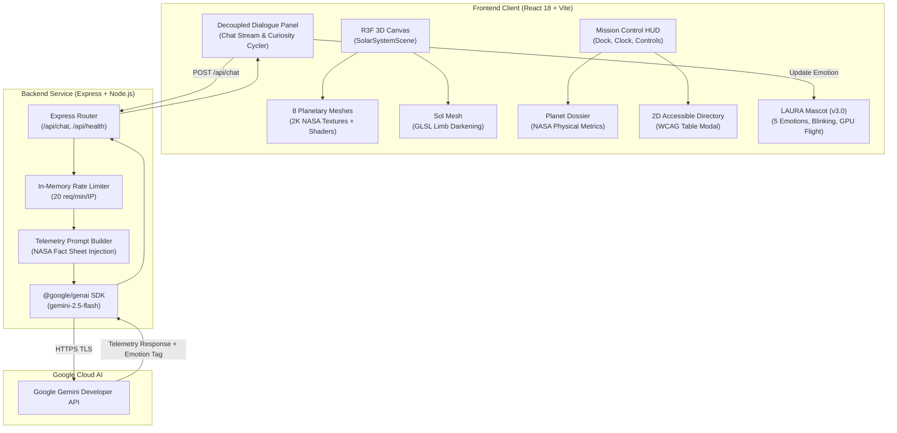

# 🪐 ORBIT ACADEMY

<div align="center">

[](https://opensource.org/licenses/MIT)
[](https://react.dev/)
[](https://www.typescriptlang.org/)
[](https://threejs.org/)
[](https://docs.pmnd.rs/react-three-fiber)
[](https://vitejs.dev/)
[](https://tailwindcss.com/)
[](https://ai.google.dev/)
[](https://expressjs.com/)

**An immersive, scientifically grounded 3D astronomical exploration platform and AI-powered learning environment.**

[Explore Features](#-current-features) • [Architecture](#-system-architecture) • [Tech Stack](#-technology-stack) • [Installation](#-installation--getting-started) • [Gemini AI Setup](#-google-gemini-ai-configuration) • [Roadmap](#-project-roadmap) • [License](#-license)

</div>

---

## 🌌 Project Overview

**ORBIT ACADEMY** transforms planetary science education into a cinematic, interactive 3D voyage. Built with **React 18**, **Three.js / React Three Fiber**, and **Google Gemini AI**, the platform places students at the helm of an authentic Mission Control interface where they can explore the Sun and all eight planets in real-time.

Rather than static textbook diagrams or simplistic illustrations, ORBIT ACADEMY renders celestial bodies using authentic **NASA/JPL photographic 2K textures**, physically motivated orbital mechanics, real axial tilts, solar limb-darkening atmospheric shaders, and verified astrophysical telemetry.

Accompanying every student is **LAURA**, an original living celestial mascot and AI guide powered by the **Google Gemini Developer API**. LAURA flies across the viewport, reacts emotionally to astronomical discoveries, and answers complex space questions in real time using NASA telemetry telemetry injection.

---

## 🚀 Current Features

All features listed below are **fully implemented and verified** in the active codebase:

### 🪐 1. Interactive 3D Solar System Engine
- **Photorealistic Planetary Rendering**: All eight planets (Mercury, Venus, Earth, Mars, Jupiter, Saturn, Uranus, Neptune) plus the Sun rendered with authentic 2048×1024 (2K) equirectangular maps synthesized from NASA, JPL, USGS, and ESA missions.
- **Solar Atmospheric Shader**: Custom GLSL limb-darkening shader implementing the astronomical photometric formula $I(\mu) = I_0(0.42 + 0.58\mu^{0.72})$ to eliminate flat yellow shading on the Sun.
- **Atmospheric Rim & Cloud Layers**: Multi-pass rendering on Earth featuring synchronized global cloud cover, Rayleigh atmospheric rim scattering, and nighttime city lights powered by NASA Suomi NPP VIIRS data.
- **Saturn Ring System**: Realistic 2048×128 radial alpha-mapped ring disc modeling the Cassini Division, Encke Gap, and ice-dust photometric absorption.
- **Orbital Mechanics**: Real-time orbital revolution and axial rotation with astronomical speeds, proportional radii scaling, and authentic axial inclinations.
- **Deep Space Visuals**: Multi-layer procedural starfield (1,200 pinpoint stars with non-attenuated pinprick glints and astronomical B-V color temperature distribution) against an all-sky Gaia DR2 / Tycho-2 Milky Way backdrop.
- **Procedural Fallback Pipeline**: Deterministic HTML5 Canvas texture synthesis ensures smooth 60 FPS operation even if external photographic assets are unavailable.

### 🛰️ 2. Mission Control HUD & Navigation
- **Cinematic Camera Transitions**: Smooth quadratic/cubic camera transitions smoothly glide the viewpoint between Solar System Overview and close-up planetary inspection orbits.
- **Interactive Celestial Reticles**: Understated scientific target reticles with hover state highlights and selection indicators that never obstruct planetary observation.
- **Planetary Quick-Access Dock**: Persistent bottom navigation bar with authentic astronomical color signatures, pulse rings, and one-click camera focus.
- **Mission Control Planet Dossier**: Slide-in telemetry panel displaying verified physical data from NASA planetary fact sheets:
  - Astronomical classification & Latin designation
  - Real distance from Sun (km and Astronomical Units)
  - Equatorial diameter (km)
  - Surface gravity ($m/s^2$)
  - Orbital period (Earth days/years) & Axial rotation period (Earth hours)
  - Atmospheric gas composition percentages
  - Mean temperature ($^\circ C$) & Known moon counts
  - Educational learning module mission objective preview
- **Simulation Clock & Controls**: Live UTC mission clock with real-time orbital speed controls (`Pause`, `0.5x`, `1x`, `2x`).
- **Keyboard Shortcuts**: Instant navigation via keyboard (`1`–`8` for Mercury through Neptune, `Esc` to return to Solar System Overview, `Space` to toggle orbital animation).

### ⭐ 3. LAURA — Celestial AI Companion (v3.0)
- **Original Sculpted Mascot Design**: Custom 5-point celestial star character with dimensional multi-stop golden shading, back-bevel depth, warm specular highlights, and blush cheeks.
- **Living Facial Expressions & Blinking**: Large expressive eyes with dual sunlit catchlights, natural intermittent blinking timer (3.5s–6.5s interval), dynamic eyebrows, and 5 distinct emotional states:
  - `idle`: Content neutral smile
  - `happy`: Uplifting warm encouragement
  - `thinking`: Inquisitive open mouth with gaze directed toward the cosmos
  - `laughing`: Wide joyful open mouth with tongue detail
  - `celebrating`: Gleaming star eyes (`★ ★`) for major scientific breakthroughs
- **True Viewport Screen-Space Flight Engine**: Decoupled flight controller moving LAURA across the entire viewport using hardware-accelerated CSS cubic-bezier transitions (`translate3d`), directional banking tilt ($\pm 16^\circ$), and landing settle.
- **Stardust Flight Trails**: Glittering particle sparkles (`✦`, `✧`, `⋆`) trailing behind LAURA during high-speed traversal.
- **Developer Waypoint Controls**: One-click flight dispatch to canonical screen coordinates (`[Home]`, `[Top-Left]`, `[Top-Right]`, `[Center]`, `[Bottom-Right]`).

### 🤖 4. Google Gemini AI Telemetry & Chat
- **Official Google Gen AI SDK**: Powered by `@google/genai` using the modern `gemini-2.5-flash` model.
- **Context-Aware Astronomical Injection**: Automatically builds dynamic system prompts injecting NASA physical metrics corresponding to the planet currently in focus.
- **Decoupled Mission Dialogue Panel**: Ergonomic floating HUD communication window that remains stable, comfortable, and readable regardless of LAURA's flight position.
- **Emotion Recognition**: Parses structured emotion tags (`[EMOTION: ...]`) from Gemini responses to dynamically synchronize LAURA's facial expressions with conversational tone.
- **Resilient Fallback Archive**: Curated offline astronomy dialogues and trivia cycler (`Next Curiosity`) if an API key is unconfigured, or during network timeouts and quota limits.
- **Secure Backend Proxy**: Express server architecture ensures `GEMINI_API_KEY` is strictly held on the backend and never exposed to the client bundle.
- **In-Memory Rate Limiting**: Client protection enforcing a maximum of 20 transmissions per minute per IP.

### ♿ 5. Accessibility & Inclusivity
- **Accessible 2D Celestial Directory**: Full-screen modal table presenting all 8 planets and the Sun with complete tabular metrics as an alternative to the 3D WebGL Canvas.
- **Reduced-Motion Compliance**: Full support for `prefers-reduced-motion` media queries; disables aggressive camera sweeps and instant-snaps LAURA waypoints when requested.
- **High Contrast & Keyboard Focus**: Accessible ARIA labels, focus rings, role declarations, and keyboard navigable controls.

---

## 🏗️ Planned Features & Roadmap

The following educational features represent the future development roadmap:

| Milestone | Target Module | Scope & Educational Objective | Status |
| :--- | :--- | :--- | :--- |
| **Phase 7A** | 🌍 **Earth Science Lab** | Interactive atmosphere layers, greenhouse effect simulation, and climate dynamics | 🗓️ *Planned* |
| **Phase 7B** | 🔴 **Mars Exploration** | Rover telemetry, Olympus Mons topography exploration, and sample analysis | 🗓️ *Planned* |
| **Phase 7C** | 🪐 **Saturn Drawing Lab** | Celestial canvas for students to paint and illustrate rings, moons, and auroras | 🗓️ *Planned* |
| **Phase 7D** | ⚡ **Jupiter Gas Lab** | Fluid atmospheric storm simulation and Great Red Spot vortex experiments | 🗓️ *Planned* |
| **Phase 7E** | 🧊 **Uranus & Neptune Quizzes** | Gamified astronomy challenges, distance calculations, and spectrum analysis | 🗓️ *Planned* |
| **Phase 8** | 🏆 **Mission Achievements** | Student flight log, collectible mission badges, and progress persistence | 🗓️ *Planned* |

---

## 🏛️ System Architecture



---

## 💻 Technology Stack

| Category | Technology | Version | Purpose |
| :--- | :--- | :--- | :--- |
| **Core UI** | [React](https://react.dev/) | `^18.3.1` | Component architecture and state management |
| **Language** | [TypeScript](https://www.typescriptlang.org/) | `~5.7.2` | Strict end-to-end type safety |
| **3D Rendering** | [Three.js](https://threejs.org/) | `^0.174.0` | WebGL scene graph, textures, and custom shaders |
| **3D React Fiber** | [@react-three/fiber](https://docs.pmnd.rs/react-three-fiber) | `^8.17.14` | Declarative Three.js component ecosystem |
| **3D Utilities** | [@react-three/drei](https://github.com/pmndrs/drei) | `^9.121.5` | Camera controls, screen reticles, and loaders |
| **Styling** | [Tailwind CSS](https://tailwindcss.com/) | `^4.0.9` | Utility-first styling with `@tailwindcss/vite` |
| **Icons** | [Lucide React](https://lucide.dev/) | `^1.16.0` | Clean astronomical and telemetry iconography |
| **Build Tool** | [Vite](https://vitejs.dev/) | `^6.2.0` | Fast HMR dev server and production bundler |
| **Backend Runtime**| [Node.js](https://nodejs.org/) & [tsx](https://github.com/privatenumber/tsx) | `^4.23.15` | TypeScript execution environment for backend |
| **Server** | [Express](https://expressjs.com/) | `^5.3.0` | Secure API gateway and proxy for Google Gemini |
| **AI Provider** | [@google/genai](https://www.npmjs.com/package/@google/genai) | `^3.3.0` | Official Google Gen AI SDK for Gemini models |

---

## 🛠️ Installation & Getting Started

### Prerequisites
Make sure you have the following installed on your machine:
- **Node.js**: `v18.0.0` or higher (Node 20+ recommended)
- **npm**: `v9.0.0` or higher
- **Git**: Latest version

### 1. Clone the Repository
```bash
git clone https://github.com/elashbharathii-dotcom/Orbit-Academy.git
cd Orbit-Academy
```

### 2. Install Dependencies
```bash
npm install
```

### 3. Configure Environment Variables
Copy the `.env.example` template to `.env`:
```bash
# On Linux / macOS
cp .env.example .env

# On Windows (PowerShell)
Copy-Item .env.example .env
```

Open `.env` and insert your Gemini API key (see [Gemini AI Configuration](#-google-gemini-ai-configuration) below).

### 4. Run Development Servers
To run both the frontend and the AI backend concurrently, open two terminal tabs:

**Terminal 1 — Frontend Web Application:**
```bash
npm run dev
```
*The interactive 3D solar system will launch at `http://localhost:5173`.*

**Terminal 2 — Express AI Backend:**
```bash
npm run server
```
*The LAURA AI companion server will initialize at `http://localhost:3001`.*

### 5. Production Build
To verify type-checking and compile for production:
```bash
npm run build
```
To preview the compiled production distribution:
```bash
npm run preview
```

---

## 🔑 Google Gemini AI Configuration

ORBIT ACADEMY integrates with the Google Gemini Developer API using the official `@google/genai` SDK.

### Obtaining a Free API Key
1. Visit [Google AI Studio](https://aistudio.google.com/app/apikey).
2. Sign in with your Google account.
3. Click **Create API Key**.
4. Copy the generated key.

### Configuration (`.env`)
```env
# Server Port (default: 3001, proxied by Vite at /api)
PORT=3001

# Google Gemini API Key (FREE TIER)
GEMINI_API_KEY=your_actual_api_key_here

# Configurable Gemini Model
# Recommended free-tier models:
# - gemini-2.5-flash (fast, multimodal, deep reasoning)
# - gemini-2.0-flash (ultra-low latency fallback)
GEMINI_MODEL=gemini-2.5-flash
```

> **Security Note:**  
> The `GEMINI_API_KEY` is exclusively read by the Node.js Express server (`server/index.ts`). The Vite dev server proxies requests from `/api/chat` to `http://localhost:3001`. The key is **never bundled** into client-side JavaScript or exposed in browser network inspection.

---

## 📂 Project Structure

```
Orbit-Academy/
├── .agents/                    # Product intelligence & agent skills
│   └── skills/
│       ├── orbit-academy/      # Product design, scientific realism & navigation specs
│       └── ui-ux-pro-max/      # UI/UX design intelligence & tokens
├── design-system/              # Design System tokens & MASTER.md
├── public/
│   └── assets/
│       └── textures/           # 2K NASA/JPL/USGS photographic planetary textures
│           └── TEXTURE_MANIFEST.md # Provenance, licensing (CC BY 4.0), and specs
├── server/
│   └── index.ts                # Express backend, rate limiter, Gemini AI integration
├── src/
│   ├── components/
│   │   ├── canvas/             # Three.js / R3F Canvas, Sun, Planets, Camera, OrbitLines
│   │   ├── common/             # Accessible 2D Celestial Directory modal
│   │   ├── companion/          # LAURA Mascot v3.0, Viewport Flight Hook, Dialogue HUD
│   │   └── hud/                # Mission Control HUD, Planet Dock, Planet Dossier
│   ├── context/
│   │   └── SolarSystemContext.tsx # Global state (active planet, speeds, camera target)
│   ├── data/
│   │   ├── celestialBodies.ts  # Audited NASA planetary telemetry & physical metrics
│   │   └── lauraDialogues.ts   # Curated offline astronomical trivia & greetings
│   ├── utils/
│   │   ├── planetaryTextures.ts # Texture loader coordinating 2K maps + fallbacks
│   │   └── textureGenerator.ts  # Procedural HTML5 Canvas planetary texture generator
│   ├── App.tsx                 # Root application component
│   └── main.tsx                # React DOM entry point
├── .env.example                # Safe environment variable configuration template
├── package.json                # Project dependencies and npm scripts
├── tsconfig.json               # TypeScript compiler configuration
└── vite.config.ts              # Vite configuration with Tailwind CSS & /api proxy
```

---

## 🪐 Planetary Data & Texture Attributions

All photographic planetary textures are distributed under the **Creative Commons Attribution 4.0 International License (CC BY 4.0)** courtesy of [Solar System Scope](https://www.solarsystemscope.com/textures/).

- **Sun (Sol)**: NASA SDO / SOHO photosphere imagery.
- **Mercury**: NASA MESSENGER spacecraft MDIS albedo mosaic.
- **Venus**: NASA Pioneer Venus Orbiter (Atmosphere) & Magellan SAR radar (Surface).
- **Earth**: NASA Visible Earth Blue Marble, Suomi NPP VIIRS (City lights), and MODIS (Clouds).
- **Mars**: USGS Astrogeology / NASA Viking Orbiter MDIM 2.1.
- **Jupiter**: NASA Cassini-Huygens ISS flyby & JunoCam belt composite.
- **Saturn & Rings**: NASA Cassini Imaging Science Subsystem (ISS) occultation data.
- **Uranus & Neptune**: NASA Voyager 2 Narrow-Angle Camera mosaics.
- **Milky Way Background**: ESA Gaia DR2 & NASA Tycho-2 all-sky star survey.

For full technical specifications and resolution data, refer to [`public/assets/textures/TEXTURE_MANIFEST.md`](public/assets/textures/TEXTURE_MANIFEST.md).

---

## 🤝 Contributing

Contributions to ORBIT ACADEMY are welcome! Whether it's adding scientific data, refining shaders, improving accessibility, or developing new educational modules:

1. **Fork the Repository**
2. **Create a Feature Branch**:
   ```bash
   git checkout -b feature/orbital-mechanics-enhancement
   ```
3. **Commit Your Changes** (follow descriptive commit messages):
   ```bash
   git commit -m "feat(canvas): add atmospheric Rayleigh scattering to Venus"
   ```
4. **Push to Your Branch**:
   ```bash
   git push origin feature/orbital-mechanics-enhancement
   ```
5. **Open a Pull Request** describing your changes and testing methodology.

---

## 📄 License

This project is licensed under the **MIT License** — see the [LICENSE](LICENSE) file for complete details.

Copyright © 2026 **Elash Bharathi I**.
